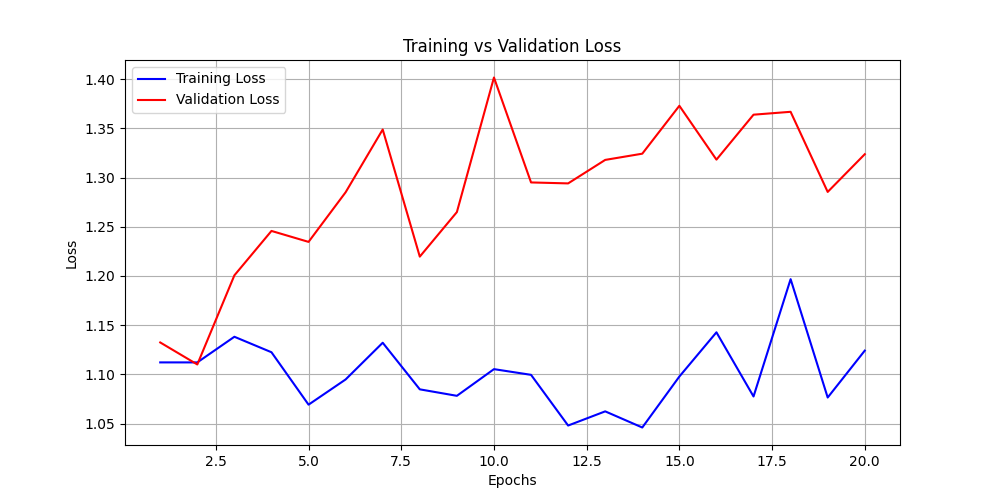
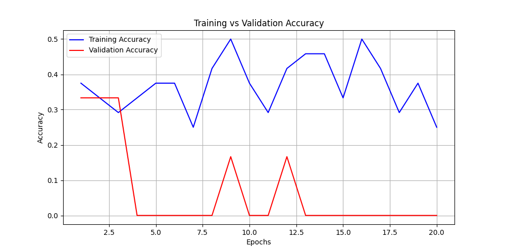
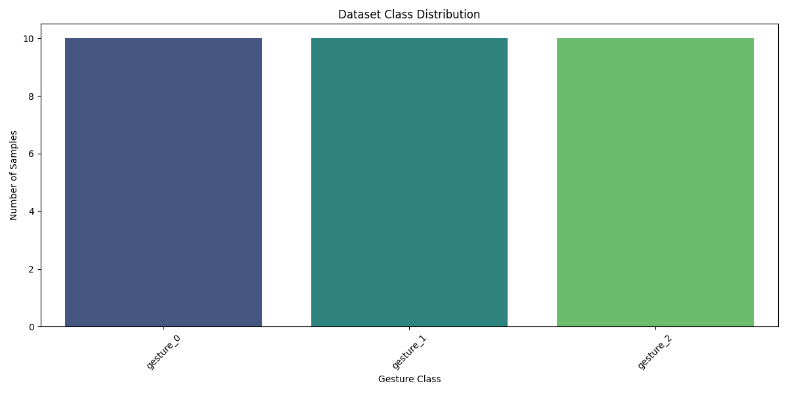

# SignifyAI - Hand Gesture Recognition System


A production-ready, real-time hand gesture recognition system leveraging Deep Learning (VGG-16 Transfer Learning) and Computer Vision. 
**Current Status**: Trained on Synthetic Data (Proof of Concept).


## 🌟 Key Features
- **Real-Time Inference**: low-latency gesture detection via webcam using OpenCV.
- **Advanced Model**: Fine-tuned VGG-16 architecture with custom classifier head.
- **Interactive Web App**: Modern FastAPI backend with a responsive HTML/JS/CSS frontend.
- **Data Tools**: Built-in tools for dataset downloading (`Kaggle`) and custom webcam collection.
- **Visualization**: Automated generation of loss curves, confusion matrices, and class distribution charts.
- **Cloud Ready**: Dockerized and pre-configured for Render.com deployment.

## 📂 Project Structure
```
SignifyAI/
├── src/
│   ├── api/            # FastAPI Application (Backend & Frontend)
│   ├── core/           # Configuration & Utilities
│   ├── data/           # Dataset Management (Download, Augment, loader)
│   ├── inference/      # Real-time Detection Engine
│   ├── model/          # Neural Network Architecture & Training Pipeline
│   └── visualization/  # Analysis & Plotting Scripts
├── data/               # Raw & Processed Data Storage
├── notebooks/          # Jupyter Notebooks for Experimentation
├── reports/            # Generated Figures & Metrics
├── Dockerfile          # Container Configuration
├── render.yaml         # Cloud Deployment Config
└── requirements.txt    # Project Dependencies
```

## 🚀 Quick Start

### 1. Installation
Clone the repo and install dependencies:
```bash
git clone https://github.com/pronzzz/signifyai.git
cd signifyai
pip install -r requirements.txt
```

### 2. Data Setup
You have two options for data:
- **Download Kaggle Dataset**:
  (Requires `kaggle.json` in `~/.kaggle/`)
  ```bash
  python src/data/download_data.py
  ```
- **Collect Custom Data**:
  Use the built-in tool to capture gestures via webcam:
  ```bash
  python src/data/collect_data.py --class_name thumbs_up --samples 200
  ```

### 3. Training
Train the VGG-16 model with transfer learning:
```bash
python src/model/train.py
```
*Metrics are saved to `checkpoints/history.json`.*
*Note: Due to missing Kaggle credentials, the current model was trained on **synthetic data** (random noise with text labels). Accuracy metrics reflect this synthetic nature.*

### 4. Visualization & Analysis
Generate performance graphs (Loss, Accuracy) and dataset insights:
```bash
python src/visualization/visualize.py
```
Outputs are saved to `reports/figures/`.

#### Performance Plots
| Training Loss | Training Accuracy |
|:---:|:---:|
|  |  |

#### Data Distribution


### 5. Run the Application
Start the local web server:
```bash
uvicorn src.api.main:app --reload
```
Visit **http://localhost:8000** to use the real-time gesture recognition interface.

## 🐳 Deployment

### Docker
Build and run the container locally:
```bash
docker build -t signify-ai .
docker run -p 8000:8000 signify-ai
```

### Cloud (Render)
This repository includes a `render.yaml`. Simply connect your GitHub repository to [Render](https://render.com/), and it will automatically deploy the service using the Docker environment.

## 🤝 Contributing
We welcome contributions! Please check [CONTRIBUTING.md](CONTRIBUTING.md) for guidelines on how to get started.

## 📄 License
This project is licensed under the MIT License - see the [LICENSE](LICENSE) file for details.
